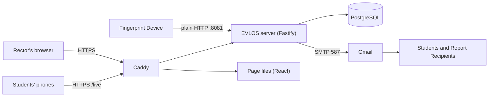

<div align="center">

# EVLOS

**Hostel Pooja attendance from fingerprint Punches.**

A fingerprint Device sends each Punch to EVLOS as it happens. EVLOS works out who was in the hostel from the Rector's Leave records, shows the Rector only the Students who need a decision, and emails a Student only after the Rector confirms the Day.

[](https://github.com/dhrumil92/EVLOS/actions/workflows/ci.yml)


**[Open EVLOS](https://evlos.vercel.app)** · **[Public Live View](https://evlos.vercel.app/live)** · [Setup guide](docs/SETUP.md) · [Deployment guide](docs/DEPLOY.md)

IT643 Software Design and Testing, term project, DAU, 2026

</div>

---

## Contents

- [The problem](#the-problem)
- [Features](#features)
- [The five rules](#the-five-rules)
- [How it works](#how-it-works)
- [Tech stack](#tech-stack)
- [Getting started](#getting-started)
- [Deployment](#deployment)
- [Commands](#commands)
- [Configuration](#configuration)
- [Testing](#testing)
- [Security and privacy](#security-and-privacy)
- [Project status](#project-status)
- [Documentation](#documentation)
- [Use of AI](#use-of-ai)

## The problem

Students of a 360-Student hostel must attend Pooja every day between 05:30 and 18:00 IST. Until now the Rector walked every room at 22:00, wrote the result on paper and retyped it into Excel, while Leaves lived in paper books.

EVLOS replaces that nightly routine with a short review on one page. The Device records each Punch, the Rector's Leaves decide who was in the hostel, and only the Students the rules cannot settle reach the Rector.

## Features

### The Rector's day

| Feature | What it does |
|---------|--------------|
| **Live view** | Each Punch appears within seconds, with a count of Students Present so far and the Device's Last Seen. |
| **Students** | Add, edit, Deactivate and Activate Students; find and filter them by floor, room or name; see each Student's month of Pooja Statuses. |
| **Leaves and Returns** | For one Student, or for 30 to 40 at once before a holiday, exactly as written in the hostel's books. |
| **Review and Finalize** | After the Pooja Window closes, only the Students on Needs Review are shown. Finalize locks the Day and turns them Absent. It warns first if the Device has been quiet, as Punches may still be on it. |
| **Exclude and Send Notifications** | The Rector leaves out any Student who explained, then sends one email to each remaining Absent Student. A Punch After Finalize is shown beside the Student, so no one is emailed by mistake. |
| **Vidyalaya Presence** | For a Day or a month, an Excel register of who was In hostel or Away, worked out from the Leaves. |

### Reports

- Opens on this month with nothing to press. Choose a Day, a Month, or Pick dates.
- Three bars for each Day (Present, Not Applicable, Absent); press a Day to see who was Absent.
- Every Student's period as a row of small squares, the most Absent first, with a Floor choice.
- Download as CSV, or as Excel with each Pooja Status in its colour, for every Student or only the Present, Absent or Not Applicable ones.

### Emails

| Email | When | To |
|-------|------|----|
| **Notification** | After Finalize, when the Rector sends it; at most once per Student per Day | Each Absent Student not Excluded |
| **Review Reminder** | 23:00 IST, only if the Day still has Students on Needs Review | Report Recipients |
| **Daily Report** | 23:30 IST, with the Pooja Report and Vidyalaya Presence as two Excel files | Report Recipients |
| **Monthly Report** | 09:00 IST on the 1st | Report Recipients |

Every email goes through an outbox: it is never sent twice, and it is tried again when the email service is unreachable. Each one is sent as formatted HTML and as plain text.

### For the Students

**[Public Live View](https://evlos.vercel.app/live)**, with no login: "42 of 100 have done Pooja" today and the 15-minute Punch bars, updated every 30 seconds. Numbers only, never a name.

## The five rules

1. A Punch counts only between 05:30 and 18:00 IST, both included (the Pooja Window).
2. The same Punch uploaded twice is stored once.
3. A Student who was Away for any part of the Pooja Window and has no Punch gets Not Applicable ("-"), never Absent.
4. A Student who was in the hostel for the whole Pooja Window and has no Punch is only Needs Review, and becomes Absent when the Rector Finalizes.
5. A Notification goes to a Student only after Finalize, and at most once per Student per Day.

Each rule is a pure function in `packages/core` with its own tests. [`TESTING.md`](TESTING.md) points to them.

## How it works



The design is **hexagonal**. The rules in `packages/core` are pure functions with an injected clock: they know nothing about the database, the Device or email. Everything outside sits behind a port, and the Device protocol, its serials and its timestamp format stay inside the Device adapter, which converts to IST at the boundary.

```
packages/core        the rules: pure functions with an injected clock, no I/O
apps/api             the server
  src/use-cases        what the Rector and the schedule do, built from the rules
  src/ports            what the use cases need from the outside world
  src/adapters         Device protocol, PostgreSQL, HTTP routes, login, email,
                       schedule loop, CSV and Excel Reports
  migrations           SQL migrations, applied in order
apps/web             the Rector's page and the Public Live View (React)
deploy               Docker Compose, the edge Caddy and the nightly backup
docs                 requirements, architecture, setup, deployment, schedule, AI log
```

Details and the reasons behind each choice are in [`docs/ARCHITECTURE.md`](docs/ARCHITECTURE.md) and [`DESIGN.md`](DESIGN.md).

## Tech stack

| Part | Choice |
|------|--------|
| Language | TypeScript (strict), Node.js 22 |
| Server | Fastify, with Server-Sent Events for the live view |
| Page | React with Vite and Tailwind CSS |
| Database | PostgreSQL (17 locally, 16 on the server) with Drizzle ORM and SQL migrations |
| Email | Nodemailer over SMTP: Gmail in production, Mailpit for local tests |
| Reports | CSV, and Excel with write-excel-file |
| Login | HttpOnly session cookies, Argon2 password hashes |
| Quality | Vitest, React Testing Library, ESLint (complexity limit 10), Prettier, GitHub Actions |
| Hosting | Google Cloud e2-micro VM (Always Free), Docker Compose, Caddy for HTTPS |

## Getting started

The full guide, step by step (database, server, page, the Rector's login, email and the Device), is in **[`docs/SETUP.md`](docs/SETUP.md)**.

**Prerequisites:** Node.js 22 (see `.nvmrc`) and PostgreSQL 17. Once, as a PostgreSQL admin, create a login role `evlos` with a password and no superuser rights, and two databases owned by it: `evlos` for development and `evlos_test` for tests (every test run wipes it).

```bash
git clone https://github.com/dhrumil92/EVLOS.git && cd EVLOS
npm install
cp .env.example .env        # put the evlos password into both database URLs
npm run db:setup            # create the tables in evlos and evlos_test
npm test
```

Then start the app in two terminals and open http://localhost:5173:

```bash
npm run rector:create -- you@example.com   # once: the Rector's login (asks for a password)
npm run dev                                # terminal 1: the server for the Device and the page
npm run dev:web                            # terminal 2: the page
```

With the settings in `.env.example`, every email goes to [Mailpit](https://github.com/axllent/mailpit) at http://localhost:8025 and none reaches a real inbox. To send real email, put the Gmail settings into `.env`, check them with `npm run email:test -- you@example.com`, and add the Report Recipients on the Settings page.

## Deployment

EVLOS runs on a Google Cloud e2-micro VM inside the Always Free limits. The full guide is in **[`docs/DEPLOY.md`](docs/DEPLOY.md)**.

| Part | How |
|------|-----|
| Containers | Docker Compose: `postgres`, `api` and `web`, built on the VM |
| HTTPS | An edge Caddy, the only thing on ports 80 and 443, with a Let's Encrypt certificate for `evlos.34-55-12-141.sslip.io` |
| Short address | [`evlos.vercel.app`](https://evlos.vercel.app), a redirect page on Vercel; nothing from EVLOS passes through it |
| The Device | Plain HTTP on its own port, 8081, and only for a registered Device Serial |
| Backup | Nightly at 00:30 IST: a checked `pg_dump`, the newest 90 kept on the VM and every one also copied to Google Drive, with a tested restore |
| Restarts | Every container restarts by itself after a VM restart |

More projects can share the same VM behind the edge Caddy: see [`docs/VM_MULTI_PROJECT.md`](docs/VM_MULTI_PROJECT.md).

## Commands

Run from the repository root.

| Command | What it does |
|---------|--------------|
| `npm run dev` | Build and start the server: the Device on `DEVICE_PORT`, the page API on `PAGE_PORT`, the Public Live View on `PUBLIC_PORT`. |
| `npm run dev:web` | Start the page at http://localhost:5173 (the Public Live View at `/live`). |
| `npm run db:setup` | Apply every migration to `evlos` and `evlos_test`. Safe to run again. |
| `npm run rector:create -- <email>` | Create a Rector's login. The password (12 characters or more) is asked at a hidden prompt. |
| `npm run rector:password -- <email>` | Set a new password for a Rector who is locked out and cannot use the emailed reset link. Every login of that Rector ends. |
| `npm run students:load -- <file.csv> [--save]` | First load of the Rector's list. Checks only, unless `--save`; then all are saved or none. Columns as in `sample-roster.csv`. |
| `npm run email:test -- <email>` | Send one test email through the SMTP settings in `.env`. |
| `npm run email:preview -- <email> [student\|daily\|monthly\|reminder\|reset]` | Send one sample email in the real design, with made-up Students and numbers. |
| `npm test` | Run every test once. |
| `npm run lint` / `npm run typecheck` | ESLint and strict TypeScript for every workspace. |
| `npm run format` / `npm run format:check` | Apply or check Prettier formatting. |

## Configuration

Every setting is an environment variable read from `.env`, and `.env.example` explains each one. `.env` is never committed. On the server the settings live in `deploy/.env` (see `deploy/.env.example`).

| Variable | What it is |
|----------|------------|
| `DATABASE_URL`, `TEST_DATABASE_URL` | The development and test databases. |
| `DEVICE_PORT`, `PAGE_PORT`, `PUBLIC_PORT` | The ports for the Device, the page API and the Public Live View. |
| `PAGE_HOST`, `PUBLIC_HOST` | The address the page API and the Public Live View listen on: `127.0.0.1` locally, `0.0.0.0` inside the server's container. |
| `TRUST_PROXY` | `true` only behind Caddy, so the request limits count each visitor's own address. |
| `COOKIE_SECURE` | `true` only when the site runs on HTTPS. |
| `PUBLIC_URL` | The address the Rector opens EVLOS at; password reset links point to it. |
| `SMTP_HOST`, `SMTP_PORT`, `SMTP_USER`, `SMTP_PASSWORD`, `EMAIL_FROM` | The email service. With no `SMTP_HOST`, emails wait in the outbox. |

## Testing

```bash
npm test
```

**1,157 tests in 110 files** (8 Nov 2026):

- the five rules as pure functions, including the IST edge cases at the Pooja Window's limits;
- the use cases with in-memory fakes;
- the HTTP routes with Fastify `inject`, including the Device protocol;
- the PostgreSQL repositories against the real `evlos_test` database, which they refuse to run anywhere else;
- the pages with React Testing Library.

Every rule was written test first. CI runs lint, typecheck, the format check and every test on each push to `main` and each pull request. [`TESTING.md`](TESTING.md) maps each rule to the tests that prove it.

## Security and privacy

- **No fingerprints are stored.** They stay on the Device; EVLOS receives only a Student ID and a time.
- **Rector login** with HttpOnly, Secure session cookies and Argon2 password hashes. The password can be changed on the Settings page, or reset with a one-time link by email.
- **Request limits:** five tries in 15 minutes for login and password, and a per-address limit on every other page route, so a flood is refused.
- **The Device endpoint** accepts only a registered Device Serial. Uploads from any other are refused and nothing is stored.
- **Audit log:** every change by the Rector is recorded.
- **Minimal data:** Student ID, name, room, email, phone, Punches and Leaves. Real Student data and the Rector's files are never committed.
- **Consent:** real emails go to Students only after the hostel agrees in writing.

## Project status

| Phase | What | State |
|-------|------|-------|
| 0 to 4 | Documents, CI, the five rules, the Device, live view, Students, Leaves, Review and Finalize | Done 2 to 3 Nov 2026 |
| 5 | Emails, Reports, Settings, password change and reset | Done 5 Nov 2026 |
| 5b | Every page in the Dawn design, Vidyalaya Presence, Public Live View, HTML emails | Done 8 Nov 2026 |
| 6 | Deployment on Google Cloud over HTTPS, nightly backup, pilot with the Rector | Deployed 9 Nov 2026; pilot to 25 Nov 2026 |
| 7 | Documents complete and repository frozen (`project-final`) | 20 to 25 Nov 2026 |

The schedule, exit checks and cut order are in [`docs/PHASES.md`](docs/PHASES.md).

## Documentation

| Document | What it is |
|----------|------------|
| [`docs/PRD.md`](docs/PRD.md) | Requirements with acceptance criteria. |
| [`UBIQUITOUS_LANGUAGE.md`](UBIQUITOUS_LANGUAGE.md) | The domain vocabulary and the ambiguities it settles. Every name in the code comes from it. |
| [`docs/ARCHITECTURE.md`](docs/ARCHITECTURE.md) | Tech stack, layers, data model, flows, deployment. |
| [`DESIGN.md`](DESIGN.md) | The five rules, design decisions, the boundary, limitations, AI use. |
| [`TESTING.md`](TESTING.md) | Which tests prove each rule, and how to run them. |
| [`docs/SETUP.md`](docs/SETUP.md) | Setting up and running EVLOS locally, step by step. |
| [`docs/DEPLOY.md`](docs/DEPLOY.md) | Running EVLOS on the Google Cloud VM: setup, Device, backup and restore. |
| [`docs/VM_MULTI_PROJECT.md`](docs/VM_MULTI_PROJECT.md) | Running more projects on the same VM. |
| [`docs/PILOT_TEMPLATE.md`](docs/PILOT_TEMPLATE.md) | The blank layout for the pilot's evidence of use: who uses EVLOS, and the feedback log. No personal data is kept in the repository. |
| [`docs/PHASES.md`](docs/PHASES.md) | Schedule, exit checks and cut order. |
| [`docs/AI_LOG.md`](docs/AI_LOG.md) | AI suggestions that were rejected or changed, and why. |
| [`AGENTS.md`](AGENTS.md) | Instructions for AI coding agents working in this repository. |

## Use of AI

The project was built with Claude Code under the rules in [`AGENTS.md`](AGENTS.md): names from the glossary, a pure core, a failing test before every rule, and small, explained changes. Every suggestion the author rejected or changed is recorded in [`docs/AI_LOG.md`](docs/AI_LOG.md), and [`DESIGN.md`](DESIGN.md) summarises how AI was used.
